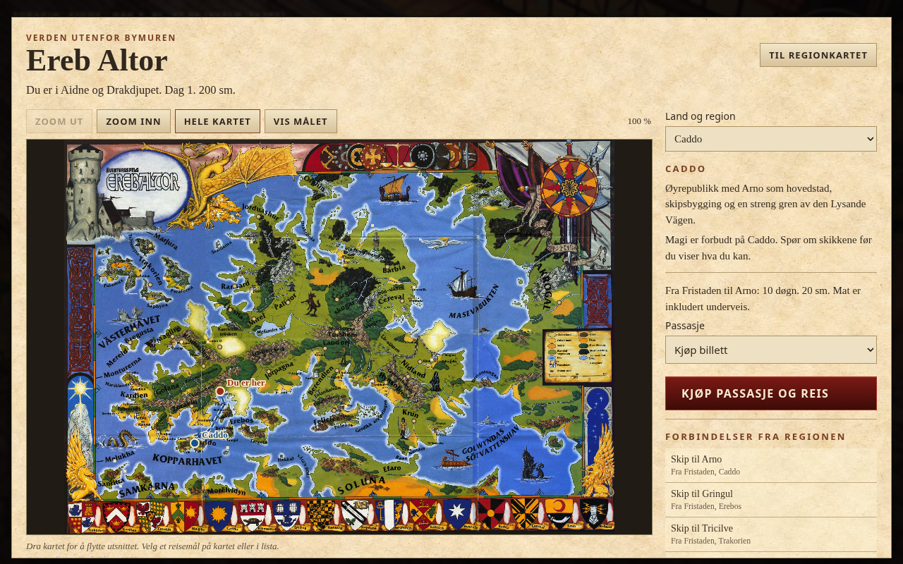
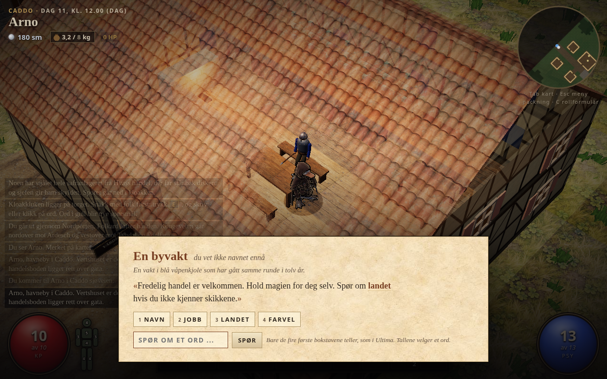

# Ereb Altor og veien videre

Gjennomgang og første utvidelse 20. oktober 2026, ChatGPT. Tom ba om videre utvikling, hele verden i Ultima-stil og bruk av [Drakar-biblioteket](https://kingafw.no/Drakar/index.html) til regler, scenarioer og verden.

Rettet 21. oktober etter Toms bestilling: originalkart med zoom og panorering, oppmålte avstander og reisedøgn. Den første sammenpressingen av bokdager til timer er fjernet fra PR #8.

Spillet har allerede mye av grunnlaget: sanntidskamp med DoD91, en by med døgnrytme og nøkkelordsamtaler, et helt bokeventyr i Edelfara, lagring og et reisekart med møter. Det som manglet for en større verden, var forbindelse mellom regioner. Det som fortsatt mangler for en lang Ultima-kampanje, er mer særpreget innhold og varige følger av spillerens handlinger.

## Det som er lagt inn i 0.8

Verdensatlaset åpnes fra regionkartet med «Ereb Altor og sjøreiser». Det har 31 regioner, 117 steder inkludert de gamle i Aidne, 30 sjøruter og 28 landeveier. Alle regionene har en vei ut og hjem. Velg et land, finn avgangsstedet på regionkartet, reis dit og gå om bord eller følg grenseveien. Du kan kjøpe passasje eller arbeide deg over med Sjökunnighet. Pris og tid vises før avreise.

Det er tre lag:

| Lag | Hva du gjør | Hva det inneholder nå |
| --- | --- | --- |
| Verdensatlas | Velger land og planlegger etapper | Ereb, Kopparhavet og forbindelser til nabokontinentene |
| Regionkart | Går langs veier, utforsker og møter folk | Ett 50 x 30-kart per region, egen utforsking og tåke |
| Lokalområde i 3D | Snakker, handler, utforsker og kjemper | Fristaden og Edelfara som før, nye havner og leirer fra områdemaler |

[Atlaset på smal mobilskjerm](ereb-altor/mobil.png). Bildene er fra det ferdige HTML-bygget i Chromium med lav grafikk.

Aidne beholder kartet og stedene som allerede var i 0.7. Nye regioner er Trakorien, Marjura, Mereld, Bzegusta, Magilre, Klomellien, Kasenu, Goiana, Jorpagna, Ljusna, Mirel, Ransard, Jorduashur, Palinor, Nargur, Barbia, Cereval, Torshem, Landori, Berendien, Felicien, Hynsolge, Grynnerbergen, Nidland, Krun, Caddo, Erebos, Samkarna, Soluna og Akrogal.

De nye havnebyene omfatter Arno, Gringul, Tricilve, Mercana, Staden O, Kapahlt, Halle, Mastika Agga, Cerevallis, Jorgund, Fervidun, Tyros, Khaanikel, Stabul og Melukha. Kiorsham og Krilloan ligger på Samkarnas kart, med transport over land mellom dem. Andre regioner har egne reisendeleirer, laget for spillet. Disse er merket `original: true` i dataene og presenteres ikke som bynavn fra bøkene.

Folk på nye steder forteller om landet og forbindelsene videre. På Caddo advarer de om forbudet mot magi. Varme regioner får noe annen bebyggelse. Dette er korte egne tekster og malområder; havnebyenes fulle gatenett, samfunn og scenarioer er ikke bygget ennå.

Utforsking og besøk huskes mellom reisene. Autolagringen etter ankomst gjenoppretter riktig region og bakgrunnsområde. En gammel 0.7-lagring uten regionfelt fortsetter i Aidne uten å miste tåke, kjente steder eller ryddede steder. En annen rettelse sperrer slipp av gjenstander fra reisekartet, der de tidligere kunne forsvinne i området bak skjermen. Den skjulte 3D-bakgrunnen tegnes høyst åtte ganger i sekundet mens et reisekart er oppe.

## Kilder og spilltilpasninger

Reglene er fortsatt DoD 4.0 fra 1991, med Expert og Gigant. Kontrakten står i [IMPLEMENTERING.md](regler/IMPLEMENTERING.md). De gamle 2023-instruksene i AGENTS.md er rettet så neste utvikler følger det som faktisk brukes.

Verdensatlaset viser originalkartet fra Ereb Altor-boksen fra 1989. Hele motivet er bygget inn som JPEG, med zoom, panorering, berøring og klikkbare markører. Det hentes ikke bilder fra nettet under spilling. Kartets 100 svenske mil tilsvarer 1000 km. Bildekilde og rettighetsavgrensning står i [assets/maps/KILDER.md](../assets/maps/KILDER.md); bokillustrasjonen er ikke merket som vår egen MIT-kunst.

Aidnes lokale rutenett og steder beholder 2024-geografien Tom tidligere valgte, med Ereno sør for Fristaden. De andre regionkartene er fortsatt egne terrengoppsett. Rutenes avstander kalibreres mot regionutsnitt fra originalkartet, mens lokale veier og bygater fortsatt trenger detaljerte kildekart. Noen havner er omtalt i bøkene uten å være navngitt på oversiktskartet. Disse punktene er anslått ved den kildeførte kysten og merket `estimated` i `geography.js`. Det gjelder blant annet Tricilve, Mastika Agga og Krilloan/Kiorsham. Vi har ikke funnet på nøyaktige bokkoordinater.

Sidelenkene under viser PDF-sider i biblioteket, som kan avvike fra sidetallet trykt på arket.

| Kilde | Brukt til |
| --- | --- |
| [Kampanjboken, PDF 10-14](https://kingafw.no/Drakar/boker/3e37a844129d/les-hele-boka.html#pdf-10) | «Bortom Ereb»: Samkarna, Soluna, Akrogal og Demontungan |
| [Kampanjboken, PDF 40](https://kingafw.no/Drakar/boker/3e37a844129d/les-hele-boka.html#pdf-40) | Havner, handelsveier og hindringen ved Raas Narram |
| [Kampanjboken, PDF 41](https://kingafw.no/Drakar/boker/3e37a844129d/les-hele-boka.html#pdf-41) | Reisetabell med seildager mellom havnene |
| [Kampanjboken, PDF 61](https://kingafw.no/Drakar/boker/3e37a844129d/les-hele-boka.html#pdf-61) og [verdenskartet](https://kingafw.no/Drakar/boker/ae66767c8db9/les-hele-boka.html) | Landnavn og relative plasseringer |
| [Spelarboken, PDF 5](https://kingafw.no/Drakar/boker/a3c541529260/les-hele-boka.html#pdf-5) og [PDF 11](https://kingafw.no/Drakar/boker/a3c541529260/les-hele-boka.html#pdf-11) | Caddo og Erebos |
| [Krilloan I](https://kingafw.no/Drakar/boker/35697e393a6b/les-hele-boka.html), «Geografi: Kiorsham» | Krilloan ved Ormsjön og omlasting via Kiorsham på Kopparhavssiden |
| [Spelledarboken](https://kingafw.no/Drakar/boker/5d1c66369cd1/les-hele-boka.html), [Trakorien](https://kingafw.no/Drakar/boker/3605eb62c335/les-hele-boka.html) og [Kopparhavets Kapare](https://kingafw.no/Drakar/boker/f58270b411fc/les-hele-boka.html) | Videre kildestoff for regioner og fremtidig innhold |

25 sjøruter har dager fra reisetabellen som `bookDays`. Fristaden–Arno tar **10 spilldøgn**, Fristaden–Gringul åtte og Arno–Gringul fire. Hyre betaler passasjen med arbeid; skipet bruker samme reisetid. Mat er inkludert på skip og behandles gjennom hele turen. De fem egne sjørutene er avstandsanslag ved 100 km per døgn, merket `uv: true`.

Landeveisetapper har oppmålte ruter og kilometer i `geography.js`. De er anslåtte ferdselsveier på kartet, ikke påstått offisielle veilinjer. Etappen gjennom Demontungan er omtrent 1364 km og krever flere måneder til fots med fjellfaktoren. Ingen landeveisetapper har lenger standardtiden fire timer.

DoD91 Bok II s. 5 gir gång 20 km og marsch 30 km på tolv timers ferd. Resten av døgnet er hvile; i spillet går dagsetappene fra seks til atten. Regn gir 75 prosent distanse, uvær 50 prosent. Marsch bruker ett Lätt SMI-slag (SG 5) per dag. Mislykket slag gir vanlig gangfart den dagen, som vår tilpasning av bokas lille missøde. Skog uten vei gir 65 prosent fart, fjell 50 prosent; dette er egne terrengfaktorer.

Spilleren får tidsanslag, matbehov og eventuelle aktive frister før avreise. Egen proviant spises hver dag. Regionreisen stopper før neste rute hvis maten ikke rekker; den kan fortsettes etter handel eller Överlevnad. En hel landeveisetappe kan tas med karavane med mat underveis, til en egen spillpris på to silver per døgn. Dette gjør lange ekspedisjoner mulige uten å bære måneders mat i sekken. Nattestans gir hvilehelbredelse og PSY bare når spilleren har mat. Tid, terreng, mat og vær avvikles raskt i virkeligheten, selv om kalenderen flytter seg mange døgn.

Edelfaras sjudagersfrist starter fortsatt ved funnet av kureren. Overfarten dit starter ikke scenarioet. Når scenarioet er i gang, løper fristen videre under reiser, og atlaset varsler om den utløper under etappen. Gamle lagringer beholder klokke, siste måltid og eksisterende frister; historisk tid blir ikke ganget opp. Nye reiser bruker `world.travelRules = 2`.

Mastika Agga ligger i Barbia og tar imot varer fra Nargur. Stabul ligger nedenfor fossene som sperrer vanlig seilas inn til Golwyndas sötvattenshav. Krilloan har ikke fått en oppdiktet ordinær skipsrute gjennom Vägen bort. Disse skillene er viktige når mer innhold legges til.

Samkarna, Soluna og Akrogal har foreløpig ett regionkart hver. Underregioner og øyriker som Orghin, Irendor og Drakarnas arkipelag trenger mer kildearbeid og egne kart. 0.8 er dermed et sammenhengende reisefundament over hovedområdene, ikke en ferdig, detaljert simulering av hele Altor.

## Hva som bør utvikles videre

### 1. La verden huske valgene dine

En stor Ultima-kampanje trenger en varig kampanjetilstand ved siden av kloakkløpet. Geografi, kjente personer, utførte oppdrag, fraksjonsrykte, forbrytelser og endrede steder skal kunne bestå når et nytt kloakkløp starter. Dagens `G.run` lagrer reisen og scenariotilstanden, men «nytt løp» er ikke en egen vedvarende kampanjemodus. Start med å definere hva som skjer ved nederlag, hjemreise og nytt løp, og legg til versjonering og migrering før mer historie bindes til dette.

Første avgrensede leveranse: stjel hos en handelsmann i Arno, reis til Tricilve og tilbake, lagre og last, og møt samme reaksjon. Et lokalt lovbrudd skal ikke automatisk gjøre hele Ereb fiendtlig. Caddos magiforbud bør få en faktisk reaksjon fra vitner og vakter før det omtales som en implementert lovmekanikk.

### 2. Gjør to havnebyer til steder du husker

Bygg Arno og Gringul med egne små bydeler, havn, vertshus, tempel og lagerhus. Gi hver by seks til ti navngitte personer med døgnrytme, forhold til hverandre og ulike opplysninger. Én person kan lyve, men en annen kilde må kunne bekrefte eller avkrefte det. Dører, gjenstander og samtaler må støtte etterforskningen.

Ferdig når du kan komme til byen uten oppdragsmarkør, forstå et problem gjennom samtaler, løse det på flere måter og se resultatet etter hjemkomst. Dagens malbyer gjør verden tilgjengelig; denne leveransen gir en grunn til å reise dit.

### 3. Bygg ett nytt bokeventyr gjennom hele kjeden

Jeg anbefaler **Edsbrytarna i Erebos** først. Det passer tyven og handelshavnene, og gir bruk for samtaler, ledetråder og sjøfart. Legg først inn et lite felles oppdragsformat: startvilkår, ledetråder, nøkkelord, gjenstander, valg, frister og avslutninger. Behold Edelfaras fungerende kode til formatet har bevist at det dekker begge scenarioene.

| Scenario eller supplement | Status i spillet | Naturlig neste bruk |
| --- | --- | --- |
| Triangeldrama i Edelfara, Ivanhoe | Spillbart fra 0.6 | Spilltest frist, bevisføring og sluttvalg |
| [Edsbrytarna i Erebos, PDF 24](https://kingafw.no/Drakar/boker/b2dbaa795638/les-hele-boka.html#pdf-24) | Kilde funnet, ingen oppdragskjede implementert | Handelsmannens omdømme, etterforskning og havn |
| [Enhörningen och Drakormen, PDF 2](https://kingafw.no/Drakar/boker/b2dbaa795638/les-hele-boka.html#pdf-2) | Kilde funnet, ingen oppdragskjede implementert | Hynsolge, Gråborg og motstridende interesser |
| Trakorien | Reisemål og korte regiontekster | Handelshus, religion og øyenes konflikter |
| Krilloan | To grunnområder og riktig adkomst | Egen storby med distrikter og eventyr |
| Kopparhavets Kapare | Ingen skipskamp implementert | Skipstyper, besetning, pirater og sjøhendelser |

Bokas gruppestørrelser og utfordringer må tilpasses én rollperson. Behold navn, motiv og dilemmaer, men kontroller alle kampdata mot DoD91 og gi veier utenom kamp. Ikke merk et scenario som ferdig bare fordi reisemålet finnes.

### 4. La reisen gi valg

Legg til et lite sett sjøhendelser med flere løsninger: storm med Sjökunnighet, syk sjømann med läkekonst, kontroll av last med sosial ferdighet, og havari med valg om å hjelpe. Deretter hester og Rida og flere havner i Aidne. Vær, dagsreiser og karavaner finnes nå som første grunnlag. Hyre sikrer at en blakk spiller kan komme hjem sjøveien.

Det skal være mulig å velge en rask, dyr tur eller en billig tur med en annen risiko. Bruk regelnotatene i [regler/](regler/) når reise og sjøfart utvides. Vis tid, mat og pris før beslutningen.

### 5. Bedre kampoversikt, grafikk og lyd

Prioriter først trær som slipper spilleren til syne, tydelige fiendeanfall og roligere kamp når mange angriper samtidig. Følgesvenner kan komme etter at varig tilstand og oppdragsformat finnes; ellers øker de både kamp- og lagringsproblemene. De manglende reglene om gift, sykdom og flere besvärjelser bør legges inn når et konkret scenario trenger dem.

Gi nye regioner egen form: nordlige langhus og gran, Caddos murverk, Trakoriens havnebyer og Samkarnas våtmark. Ulike navn over samme bymal er utilstrekkelig som sluttresultat. På lydsiden gir underlagssteg, dører, havn, vind og lokale musikkmotiver mye tilstedeværelse. Konkrete gjenbrukskilder og lisensvurderinger finnes allerede i [gjenbruk.md](gjenbruk.md).

Behold WebGL 2 og three r170 mens dette bygges. De viktige gevinstene nå kommer fra innhold, lesbarhet, riktig lys og ytelse på svakere maskiner. Et bytte av grafikkmotor vil også kreve arbeid med shaderne og den selvstendige HTML-fila.

## Teknisk overlevering

- `atlasdata.js` er land, korte sammendrag, kildepekerne og scenariokatalogen. Markørene kommer fra `geography.js`. Katalogen lover ikke nye spillbare scenarioer.
- `geography.js` er bildekoordinater på en referanse 1856 x 1333 og skala 1000 km per 189 piksler. `journeytime.js` beregner dagsetapper, nattestans og værskifter. Ikke bytt kartbilde eller målestokk uten å oppdatere kalibreringen.
- `regionalmaps.js` gir globale sted-ID-er, uendrede Aidne-data, nye terrengoppsett og toveis forbindelser. Regionenes navn og plassering er kildeført; lokale veier og pass er laget for navigasjon i spillet.
- `worldtravel.js` bruker aktivt regionkart. `G.run.world.region` velger kart, og `maps[id]` lagrer utforsking. `known`, `done` og `cleared` bruker globale sted-ID-er. Oppslag for vei og sted må oppdateres ved regionbytte.
- `atlastravel.js` sjekker avgangssted, pris og spilltilstand før avreise, behandler klokke og mat, og beholder de siste 80 reisene. Atlaset håndterer ikke sjøkamper.
- `atlasview.js` viser første etappe mot et fjernt mål. Du må selv gå til avgangen; valg av et land teleporterer ikke spilleren. Flere avganger til samme region kan velges separat, blant annet Melukha og Kiorsham.
- `areatemplates.js` gir de nye stedene tjenestene fra landsbymalene og egne regionale samtaler. Nye bygg-ID-er inneholder region og sted for å unngå kollisjon i taktilstanden.

## Kontroller

`node --test tools/test/atlas.test.mjs tools/test/combatfx.test.mjs` kontrollerer blant annet hele forbindelsesnettet, at alle 117 steder kan nås til fots på sitt kart, gammel lagring, separat utforsking etter JSON-lagring, billett og klokke, avreisekrav, gratis hyre med mat gjennom en lang tur, gjenstander og Krilloans adkomst.

`tools/test/atlas-browser.mjs` kjører mot den ferdige HTML-fila fra Pages-undermappa med Playwright. Den prøver reise fra Fristaden til Arno, vern mot dobbeltkjøp, samtaler i Arno, Trakorien, last av en eldre Arno-lagring, gratis hjemreise, en fysisk grenseovergang, inventarvernet og mobilvisning. Konsollfeil gjør testen rød. Egen atlasjobb i PR-kontrollen lagrer skjermbilder og resultatfil som `verdensatlas-test`.

Bygget beholder de 50 material-/UI-bildene på 3 856 040 byte. Originalkartet bygges inn separat med 1 817 818 byte. HTML-fila er omtrent 9,4 MB og er under grensen på 16 MiB. Ingen nye eksterne ressurser hentes under spilling. Automatisk mobiltest er ikke en spilltest på fysisk telefon. Reisefrekvens, økonomi og nye regioners vanskelighetsgrad trenger fortsatt vanlig spilltesting.

22 regresjonstester dekker nå også målestokk, reisedøgn, nattestans, vær, proviant, karavane og frister uten å reskalere gammel tid. [Nettleserresultatet](ereb-altor/resultat.json) og bildene oppdateres fra det ferdige bygget. Testen prøver også kartets zoom, panorering og havnevalg. Headless Chromium bruker programvaretegning; dette er ingen måling av ytelse på en spillmaskin.
