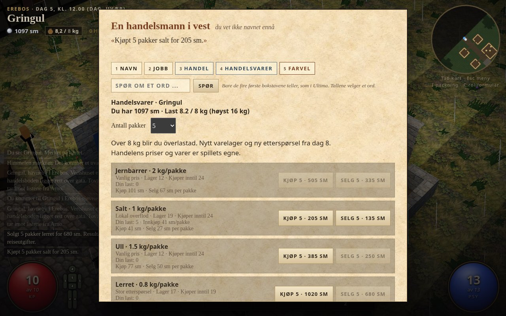
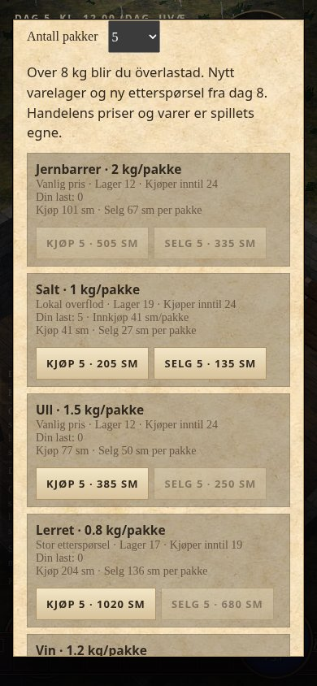

# Handel mellom byene

Fra 0.11 kan du kjøpe og selge seks handelsvarer: jernbarrer, salt, ull, lerret, vin og krydder. Snakk med Herr Nansen eller Hvass i Fristaden, eller kjøpmannen i en av regionenes handelsboder. Velg **HANDELSVARER**. Handelsboden er åpen klokka 8–20, Nansens disk klokka 7–21.

Velg 1, 5 eller 10 pakker. Hver vare viser kjøpspris, salgspris, vekt, lager, etterspørsel og hvor mange du bærer. Knappen viser totalen. Kjøpet gjennomføres bare hvis pengene, lageret og bæreevnen holder. Du kan bære opp til 2 × STY kg; over STY blir du överlastad som med annen packning. Handelslast bruker sekken, også om bord. Dette gir ikke egen skipslast eller en kjerre.

## Første tur

Jern kjøpes for 66 sm per pakke i Fristaden og selges for 104 sm i Pendon ved nøytralt rykte. Ull er billig i Pendon og dyrere i Fristaden. Arno selger lerret for 74 sm; Gringul kjøper det for 136 sm. Salt går motsatt vei. Prisene er i silvermynt per pakke, og varierer med sted, havnas tillit, laugsforhold og rykte. Rabatter kan aldri gi fortjeneste ved straks å selge tilbake på samme marked.

Fem pakker lerret koster 370 sm og veier 4 kg. Salg i Gringul gir 680 sm. Fire døgns passasje fra Arno koster 8 sm med dagens reiseregler, altså 302 sm igjen av prisforskjellen etter denne billetten. Mat er inkludert på skipet. Reise til avgangshavna, eventuell retur, innkjøp av returvarer og andre utgifter kommer i tillegg. Tid, oppdragsfrister og risiko følger de vanlige reisene.

**Prisboka** viser sist observerte tilbud i markeder du har besøkt, med dagstall. Den oppdaterer ikke fjerne markeder. Salg viser gevinst eller tap mot den betalte innkjøpsprisen, før reiseutgifter. Innkjøpet fordeles mellom pakkene hvis du selger eller slipper deler av lasten.

Lager og etterspørsel er begrenset. Markedene får nytt lager hver sjuende spilldag, første gang ved starten av dag 8. Gjenåpning av samtalen, gjenbesøk og lasting fyller ikke opp lageret. Ukentlig påfyll krever at spillklokka passerer en ny uke.

Varene, økonomien og fordelingen av overflod/etterspørsel er spillets egne. De er ikke bokas varepriser eller påstander om Ereb Altors kanoniske eksport. Videre økonomisk kalibrering kan gjøres ved vanlig spilling.

## Lagring og kode

- Handelsvarer ligger som `type: 'trade'` i spillerens vanlige `bag`, med vare-ID, antall og samlet innkjøpskostnad (`basis`). Utstyr og silver følger løpet. Lasten følger samme regel ved et nytt kloakkløp.
- `campaign.areas[place].market` har eget `v: 1`, uke, lager, gjenværende etterspørsel og siste observerte tilbud. Kampanjen beholder dette mellom løp.
- Hver gjennomført handel autolagrer penger, last og marked i samme øyeblikk. En eldre lagring gjenoppretter alle tre sammen. Ved lagringsfeil vises beskjed. Gamle lagringer har tom handelslast og får marked ved første besøk; format 3 er beholdt.
- `tradedata.js` har egne varer og markedsprofiler, `trading.js` priser og transaksjoner, `tradeui.js` vinduet. `HANDEL` i `dod.js` er merket `uv: true`. Eksisterende utstyrsbutikker og proviant er beholdt.
- Handelsvarer selges bare gjennom markedet. Vanlig utstyrssalg kan ikke omgå lokale priser eller etterspørsel. Hvert klikk beregner transaksjonen på nytt.

## Kontroller

`node --test tools/test/*.test.mjs` omfatter blant annet penger/vekt, ingen deltransaksjon ved avslag, begrenset lager/etterspørsel, ukentlig påfyll, innkjøp ved deling/stabling, lagringsøyeblikk og fortjeneste etter faktisk rutetid/billett. Alle besøksbare markeder kontrolleres mot kjøp-og-straks-salg med rabatter.

`CHROME=/usr/bin/chromium node tools/test/trading-browser.mjs dist/handel-test` bruker synlige handelsknapper, kjøper lerret, åpner siden igjen med Fortsett, reiser fire spilldøgn til Gringul, selger med fortjeneste og kjøper salt. Den kontrollerer også prisbok og knapper på 390 piksler. Prøven kjører i PR og før Pages-publisering. Det er en nettleserprøve, ikke en fysisk mobiltest.

| Markedet i Gringul | Handelsknapper på 390 px |
| --- | --- |
|  |  |

[Lokal nettleserprøve](handel/resultat.json) og [femnivå-stress](handel/stress.json) bestod uten konsollfeil. 47 datatester er grønne. Bygget er 9 415 587 byte, 8396 mer enn 0.10.1. De 50 innebygde bildene er uendret; ingen nye runtime-filer eller avhengigheter.
