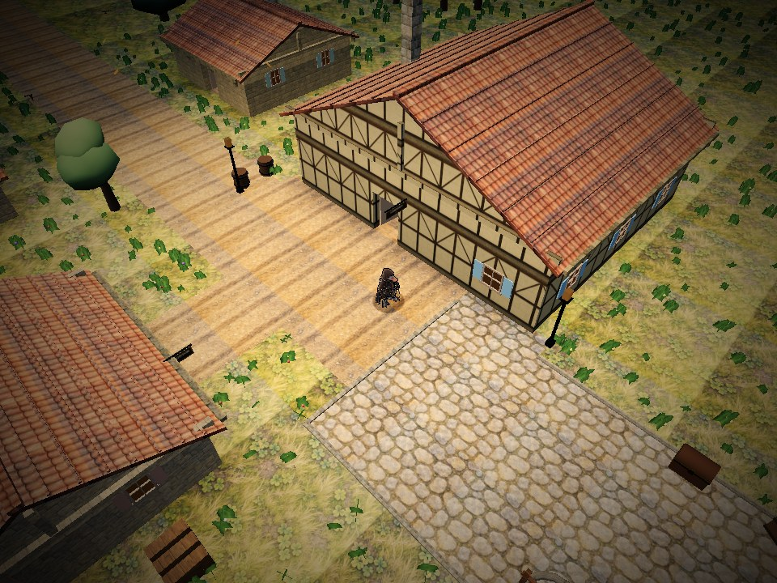
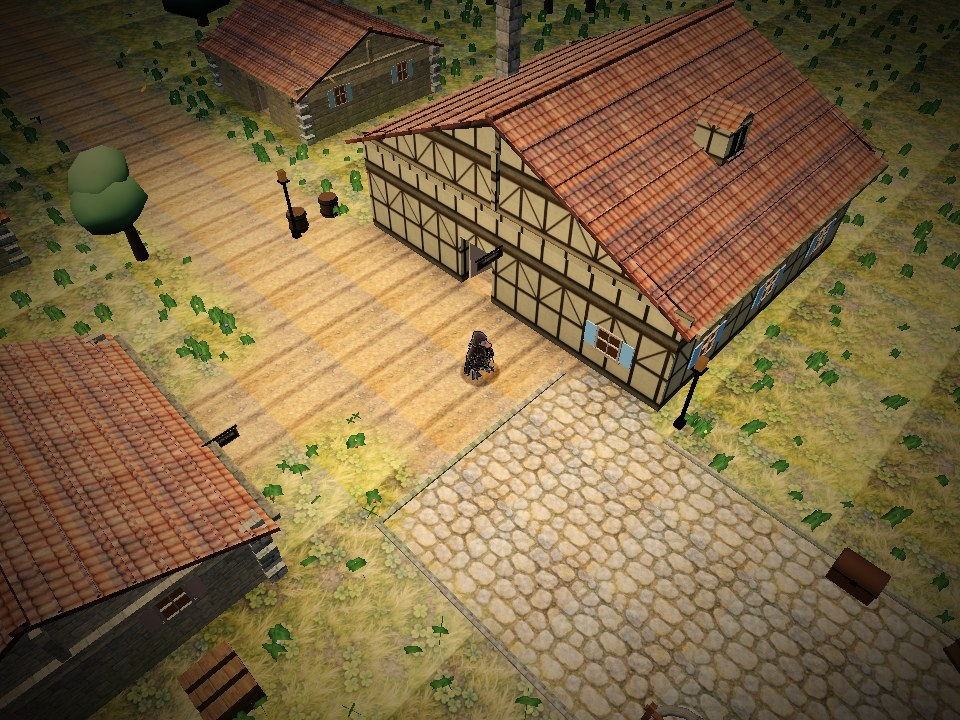
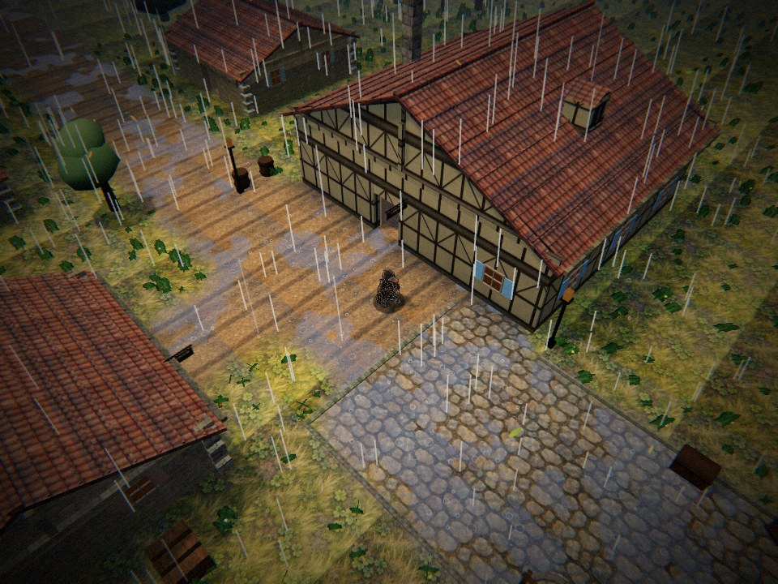
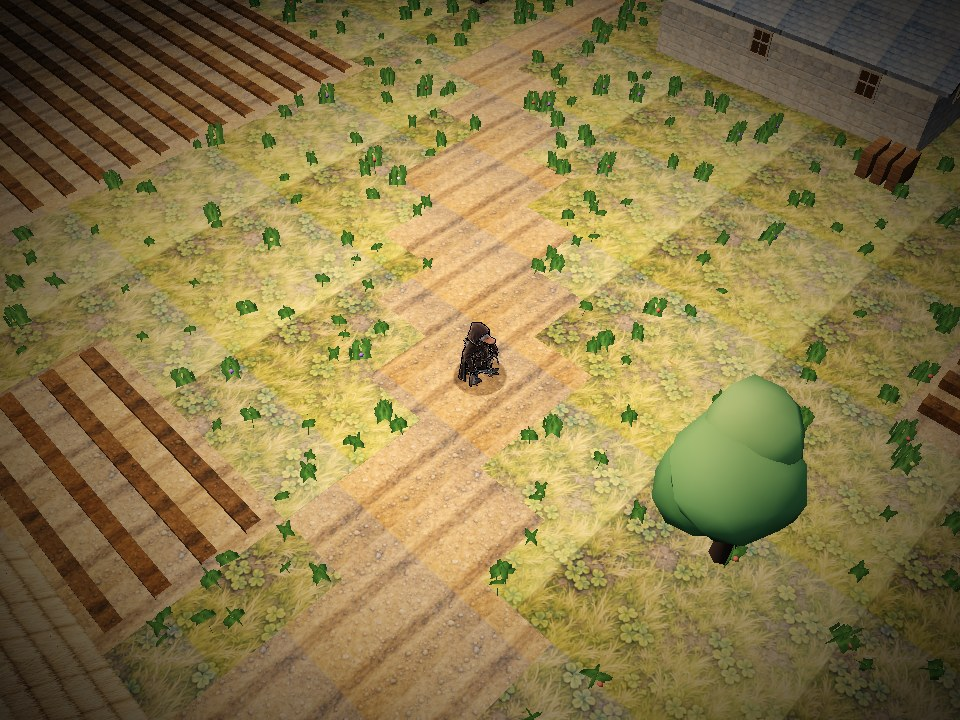

# Materialer, hus og terreng i 0.10

Tom ba om mer levende materialer, varierte middelalderhus og bedre overganger i terrenget. Dette er egen JavaScript-/shaderkode over de eksisterende malte teksturene. three.js er fortsatt r170. Ingen nye runtime-bilder eller avhengigheter er lagt til, og ingen spillregler eller reisetider er endret.

Veilogikken fra denne versjonen er senere rettet i [0.10.1](veikanter.md). Den bruker faktiske veiløp og egne jordskuldre, og retter kantstein og stikkveier som brøt sammenhengen i 0.10. Tallene nedenfor beskriver den opprinnelige 0.10-leveransen.

## Overflater og hus

`surfaces.js` legger farge- og ruhetsvariasjon i verdensrom, med mose på lave steinflater, mørkere treverk ved bakken og ujevn patina på tak. Større flekker bryter opp de gjentatte teksturene. Været mørkner og blanker takene, og eksisterende skyskygger beveger seg nå over dem også. De malte kartene og normalkartene beholdes.

`housestyle.js` velger detaljer fra stabil bygnings-ID. Lave stuer har tykkere halmskjegg, verksteder får synlige gavlbånd, større bygårder får takoppløft og murhus får hjørnekvadre. Takvinklene varierer. Arnos tidligere takretninger, farger og gesimser beholdes. Tempel og tårn beholder særformene sine. Detaljene samles i takets eksisterende materialgrupper og forsvinner når taket tones bort. Dører, vindusplassering, rom, kollisjon og møbler flyttes ikke.

| Arno før, 0.9 | Arno etter, 0.10 |
| --- | --- |
|  |  |

## Overganger i bakken

`terrainfield.js` lager et lite felt fra det eksisterende rutenettet. Gress, jord, brostein og skogbunn får kontinuerlige vekter over flisekantene. `terrain.js` blander både farge og tangentnormaler, og bryter opp kanten med støy i verdensrom. En større fargevariasjon skjuler noe av repetisjonen. Husgulv, bruer, vann og murer holdes utenfor feltet. Gress og skog blir fuktige; pytter oppstår bare på jord og brostein.

Bakgrunnen i Area deles nå i to meter brede flater, slik at vektene kan følge terrengkantene. Innenfor det gangbare kartet brukes de eksisterende halvrutene. Dette er rent visuelt. Rutenett, stifinning, kollisjon, fotsteg og mat-/reiseregler er uendret.

| Stien i Sortmund før | Stien etter |
| --- | --- |
|  |  |

## Kontroller og kostnad

`tools/test/landscape.test.mjs` kontrollerer normaliserte og kontinuerlige terrengvekter, utelatte hus-/vannfelt og faste husvarianter med uendret grunnriss og dører. Sammen med de eksisterende datatestene er det 35 tester.

`tools/test/landscape-browser.mjs` åpner HTML-bygget fra Pages-undermappa i Chromium/SwiftShader. `ROOT` kan peke på en urørt worktree og `BASELINE=1` tar bare førbildene. Referansen er 34d1393. Kamera, klokke og tilfeldig seed er like. Bildene viser lav kvalitet; regnbildet viser middels. Fysisk mobil og bildefrekvens på vanlig maskin er ikke målt.

Den frosne renderprøven skifter terrengblanding, materialdetalj og fuktighet hver for seg. Bildene gjentas med samme innstillinger, og som negativ kontroll skjules akkurat de berørte materialene. Resultatet er henholdsvis 66 541, 124 696 og 593 600 endrede piksler ved 960 x 720. Gjentakelse og negativ kontroll gir null i alle tre prøver. 45 700 terrenghjørner har gyldige vekter, 2584 blander flere overflater. Takoppløftet forsvinner sammen med taket innendørs og har identisk geometri ved nytt besøk. Ingen konsollfeil.

| Utsnitt, lav kvalitet | Tegnkall før/etter | Trekanter før/etter | GPU-teksturer før/etter |
| --- | --- | --- | --- |
| Fristaden | 184 / 183 | 177 822 / 178 433 | 41 / 43 |
| Arno | 194 / 192 | 124 386 / 136 541 | 43 / 45 |
| Sortmund | 90 / 89 | 115 248 / 127 496 | 47 / 49 |

Terrengflatene gir flere trekanter i områdene. Samlingen av overflater sparer tegnkall, mens skogbunnens to eksisterende teksturer nå lastes til GPU også der de ikke var synlige før. Tabellen er ressursmåling i disse utsnittene, ikke et FPS-løfte eller en måling av maksimal belastning. HTML er 9 405 017 byte, 9441 mer enn 0.9. Bildesettet er uendret, 3 856 040 byte.

[Resultat før](landskap/kontroll-for.json) og [etter](landskap/kontroll-etter.json) inneholder alle utsnitt og kontroller. PR-kontrollen har en egen landskapsjobb, og samme fullprøve kjøres før Pages-publisering.

[Spillstressen](landskap/kontroll-stress.json) bestod fem nivåer og åtte oppryddinger uten konsollfeil. Fullt bildesett, tomt sett og ødelagt gressnormal er også rendret med WebGL i texture-fallback.mjs. Den prøven rendrer nå uttrykkelig før feilkontrollen, og testjobben har 20 minutter til de ekstra shaderkompileringene.
