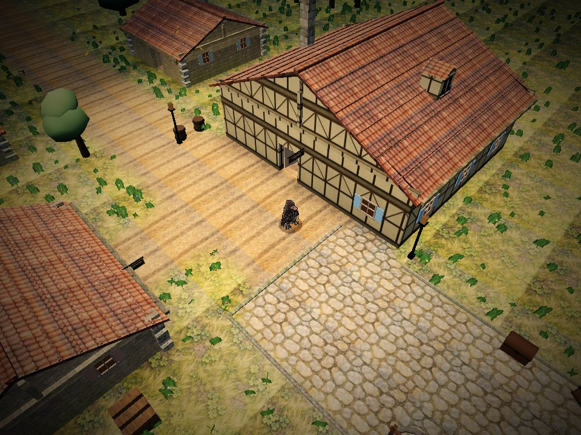
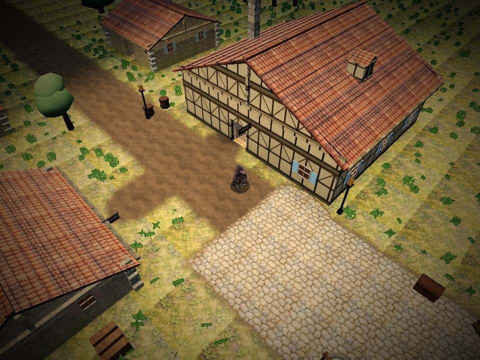
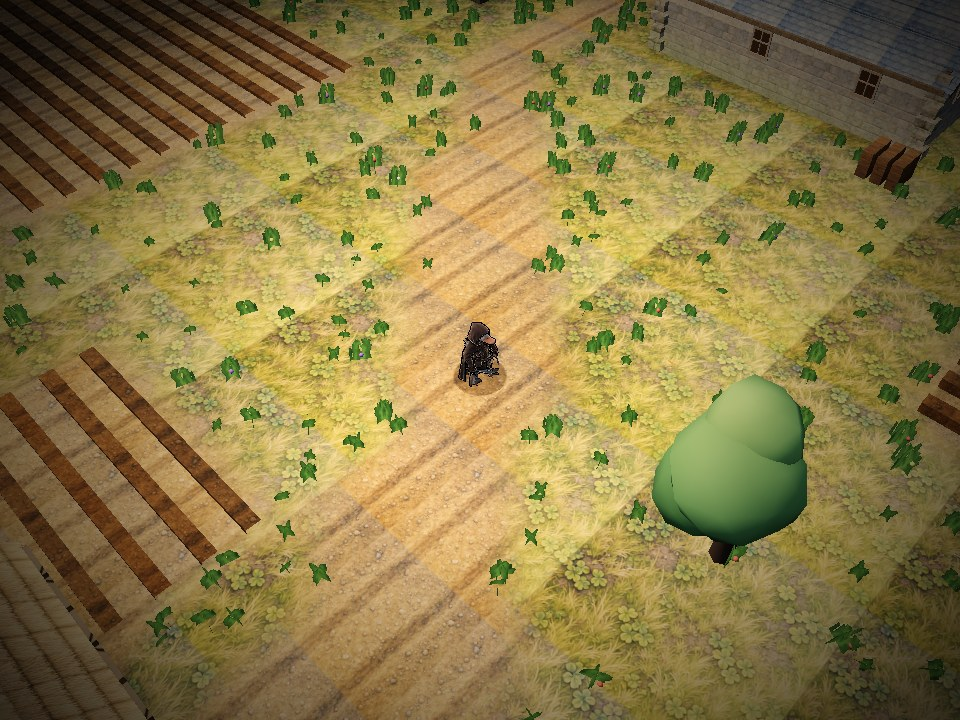
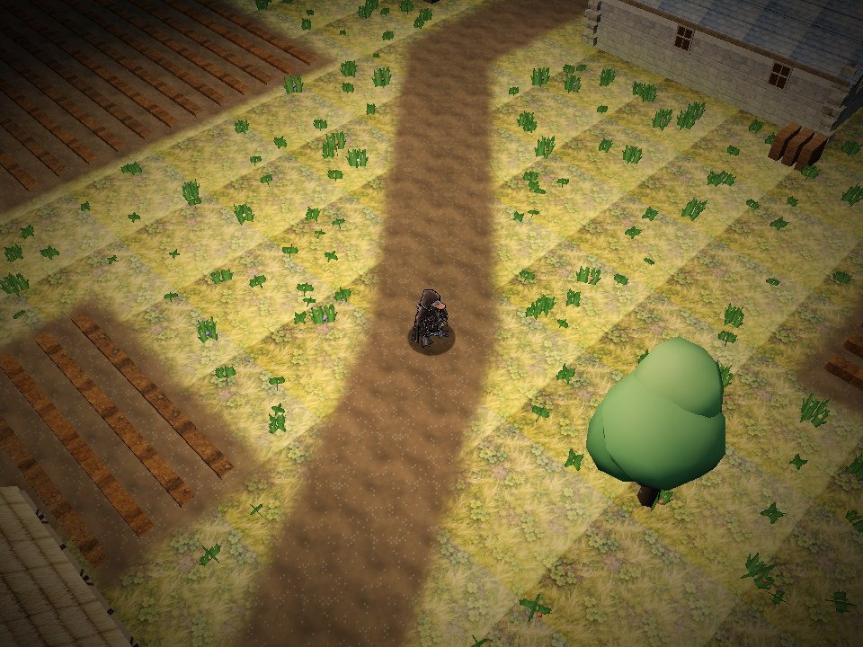

# Veier og naturlige overganger, 0.10.1

Tom påpekte at veier, brostein og gress ikke hang sammen etter 0.10. Nabofargene ble blandet, men jordkartet hadde faste striper på tvers av veiløpet, generiske kantsteiner skar over adkomster, og stikkveier malte jord gjennom ferdig brostein. Det er rettet i 0.10.1.

## Sammenheng i bakken

- Veibanen følger de faktiske punktene og bredden fra `k.road`, også i svinger. Fristadens rektangulære jordgater får tilsvarende midtlinjer. Overgangen styres av avstand i meter fra veikanten.
- Brostein har en fast kjerne. Utenfor ligger en smal, slitt jordskulder, deretter gress eller skogbunn. Små avvik i steinkanter og jordkant gir slitasje, mens selve veibanen beholder formen.
- Jordveier møter belegningen uten gressbånd eller kantstein over innkjøringen. Jordtilkomst i kartbyggeren beholder eksisterende brostein og heller. Torg blir ikke lenger revet opp av stiene som kommer inn fra husene.
- Veijorden er kornet jord med småstein, laget med den eksisterende jordfabrikken. Den har ingen parallelle furer som kan peke feil vei. Furene i det malte jordkartet brukes fortsatt på åkre.
- Gresstuster holdes minst 0,8 meter utenfor vei og brostein. Veien får en lesbar bane med fri skulder; vegetasjon vokser langs utsiden.

| Arno, 0.10 | Rettet veimøte, 0.10.1 |
| --- | --- |
|  |  |

| Sortmund, 0.10 | Sammenhengende veiløp, 0.10.1 |
| --- | --- |
|  |  |

Kamera, klokke og seed er like. Førbygget er 2123119. Bildene er fra Chromium/SwiftShader på lav kvalitet, ikke en ytelsesmåling på fysisk mobil.

## Kontroll av logikken

40 data-/regresjonstester bestod. De nye tilfellene prøver brosteinskjerne og jordskulder, sammenheng gjennom en sving, åpen overgang fra vei til plass, malingsrekkefølge for brostein/heller og klaring for vegetasjon. Åtte faste gangkart er sammenlignet med 2123119: grid, bmap, doorMap, bridge og kind er identiske. Overflatematerialet beholder nå korrekt brostein/heller der en jordvei kommer inn. Kollisjon og gangruter er uendret.

Nettleserprøven går videre enn før-/etterbilder. Den renderer de faktiske shadervektene ovenfra: rødt for brostein, blått for jord og grønt for vegetasjon. Den måler tolv punkter langs veien gjennom begge sider av plassen. Alle har null vegetasjon, og jord + brostein summerer til 255. Kjernene gir rent forventet materiale, også ved motsatt adkomst der brosteinen tidligere ble malt bort. Et kontrollpunkt utenfor skulderen gir rent vegetasjonsmateriale. Ingen av de 1667 kontrollerte gresstustene står i veibanen eller den indre skulderen.

Vanlige bilder, regn, blandede normaler, shaderkompilering, takfading, gjenbesøk og negative renderkontroller består uten konsollfeil. Femnivå-stress med åtte oppryddinger bestod også. Fullt/tomt/ødelagt bildesett er rendret med WebGL. [Grafikkresultatet](veikanter/kontroll.json) og [spillstressen](veikanter/stress.json) ligger ved.

## Teknisk omfang

`terrainfield.js` bruker signerte materialavstander og de faktiske veisegmentene, med jordskuldre og vegetasjonsklaring. `terrain.js` bruker `terrainDistances` og `terrainTraffic`; farge og normaler følger samme vekter. De generiske kantsteinene er fjernet fra Town.buildGround. Egne framtidige bygde kanter må ha eksplisitte åpninger ved adkomster.

Veijordens farge-/normalpar genereres én gang i 256 x 256 og deles med vanlig jordgulv. Ved reservebilder gjenbrukes jordparet. Ingen nye bildefiler lastes, og de 50 innebygde bildene er uendret. HTML er 9 407 235 byte, 2218 mer enn 0.10. three.js r170, lagringsformat, spillregler og reisetider beholdes. PR og Pages kjører den utvidede grafikkontrollen.
